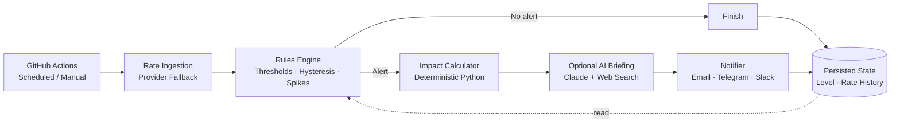

# Foreign Exchange Alert - USD/KRW Exchange Rate Monitoring

A serverless Python application that monitors USD/KRW exchange rates, detects meaningful changes, and sends personalized alerts with optional AI-generated news briefings.

**Stack:** Python · GitHub Actions · REST APIs · Claude API · YAML · pytest

## Key Features

- **Resilient ingestion:** Fetches exchange rates with automatic fallback across EXIM, Open ER API, and Frankfurter.
- **Stateful alerts:** Configurable thresholds, hysteresis to reduce repeated notifications, 24-hour spike detection, and recovery alerts.
- **Personalized impact:** Calculates the KRW cost of configured USD expenses against a historical baseline using deterministic Python logic.
- **AI-assisted context:** Uses Claude with web search to summarize potential news drivers *only when an alert triggers*; notifications remain available without AI.
- **Automated delivery:** Scheduled GitHub Actions workflow with email, Telegram, and Slack notification options.

## Architecture



**Design decisions**

- **Reliability:** Multiple rate providers provide fallback when an upstream API fails.
- **Noise reduction:** Hysteresis avoids repeated alerts when rates fluctuate around a threshold.
- **Separation of concerns:** Python handles numeric calculations and alert decisions; the LLM only generates explanatory context.
- **Cost and fault tolerance:** AI runs only on alert events and is optional; a briefing failure does not block delivery.
- **Lightweight operations:** GitHub Actions removes the need for an always-on server.

## Quick Start

```bash
pip install -r requirements-dev.txt
cp .env.example .env  # Add notification credentials and optional API keys
pytest -v
python -m fx_alert --dry-run
python -m fx_alert --force-rate 1405 --dry-run
```

Adjust thresholds, provider priority, spending scenarios, and AI settings in [`config.yaml`](config.yaml). To automate, add the required credentials as GitHub Actions repository secrets and run the **FX Alert** workflow manually or on its configured schedule.

## Example Alert

```text
[Warning] USD/KRW 1,405 — crossed 1,400
24h change: +2.18%
Monthly $500 transfer: ₩702,500 (+₩29,950 vs. baseline)
AI briefing: [News-based explanation and source links]
```

*Illustrative output; not a live exchange-rate quote.*

## Project Structure

| Component | Responsibility |
|---|---|
| `fx_alert/fetcher.py` | Rate retrieval and provider fallback |
| `fx_alert/rules.py` | Alert rules and spike detection |
| `fx_alert/state.py` | Alert state and rate history |
| `fx_alert/impact.py` | Personal spending impact |
| `fx_alert/ai_briefing.py` | Optional sourced AI briefing |
| `fx_alert/notifier.py` | Notification formatting and delivery |
| `fx_alert/main.py` | Application orchestration and CLI |

## Limitations

Public exchange-rate sources are generally updated daily, so hourly scheduling does **not** guarantee intraday market data. A real-time provider would be needed for intraday alerts.

## License

MIT
